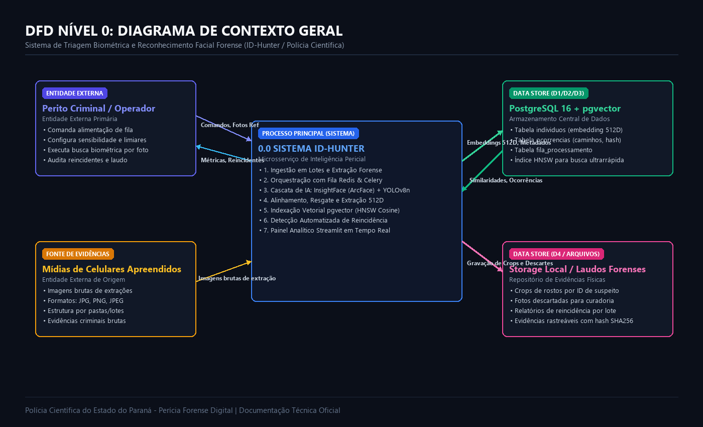
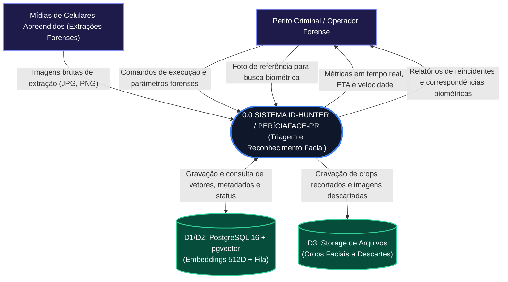
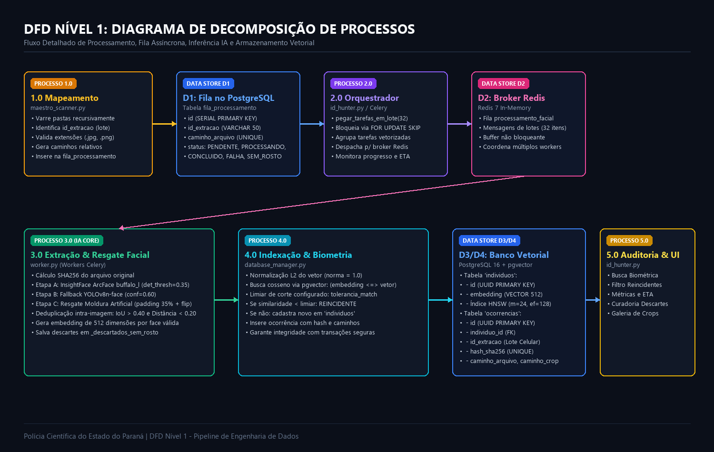

# DFD - Diagrama de Fluxo de Dados: Sistema ID-Hunter / PeríciaFace
**Polícia Científica do Estado do Paraná (SESP-PR)**  
*Documento de Engenharia de Dados e Especificação de Fluxos Forenses*  
*Versão: 2.4 - Fase Operacional Piloto*

---

## 1. Visão Geral e Propósito do Documento

O presente documento especifica o **Diagrama de Fluxo de Dados (DFD)** do sistema **ID-Hunter** (módulo operacional do projeto **PeríciaFace-PR**). O sistema tem como objetivo realizar a ingestão automatizada, triagem algorítmica, extração de assinaturas biométricas (vetores de 512 dimensões) e identificação de suspeitos reincidentes presentes em mídias apreendidas (smartphones e cartões de memória) em investigações criminais.

A notação adotada segue o padrão estruturado de engenharia de software (**Gane & Sarson / Yourdon & DeMarco**), cobrindo desde o nível de contexto geral até a decomposição funcional da esteira de Inteligência Artificial e armazenamento vetorial.

---

## 2. DFD Nível 0: Diagrama de Contexto Geral

O Diagrama de Contexto estabelece os limites do sistema, delimitando com clareza as entidades externas produtoras/consumidoras de informação e os fluxos limítrofes.





### 2.1. Entidades Externas
1. **Perito Criminal / Operador Forense:**
   - *Entradas no sistema:* Inicia a varredura, define sensibilidade dos parâmetros forenses (limiares de corte, tolerância biométrica, tamanho mínimo de face), insere fotos de referência para cruzamento biométrico e comanda paradas/resets.
   - *Saídas recebidas:* Métricas operacionais em tempo real (FPS, FPM, ETA), relatórios visuais de reincidência entre diferentes apreensões, percentual de similaridade de investigados e galerias de curadoria.
2. **Mídias de Celulares Apreendidos (Fontes de Evidência):**
   - *Entradas no sistema:* Conjunto de arquivos de imagem extraídos de smartphones via ferramentas forenses (Cellebrite UFED, Oxygen, Magnet AXIOM), organizados em pastas estruturadas por lote de apreensão.

---

## 3. DFD Nível 1: Decomposição de Processos

O Diagrama de Nível 1 decompõe o sistema em **cinco subprocessos essenciais**, mapeando as tabelas e brokers que intermedeiam as trocas de dados.

```mermaid
flowchart LR
    classDef proc fill:#1e293b,stroke:#3b82f6,stroke-width:2px,color:#ffffff;
    classDef data fill:#0f172a,stroke:#10b981,stroke-width:2px,color:#ffffff;
    classDef broker fill:#3b0764,stroke:#d946ef,stroke-width:2px,color:#ffffff;

    Midia[("Mídias de Entrada")] -->|"Pastas por Lote"| P1["1.0 Mapeamento & Ingestão\n(maestro_scanner.py)"]:::proc
    
    P1 -->|"Tarefas PENDENTES\n(caminho, id_extracao)"| D1[("D1: Fila no PostgreSQL\n(fila_processamento)")]:::data
    
    D1 -->|"Tarefas Bloqueadas\n(FOR UPDATE SKIP LOCKED)"| P2["2.0 Orquestrador de Despacho\n(id_hunter.py)"]:::proc
    
    P2 -->|"Lotes Vetorizados\n(32 tarefas por pacote)"| D2[("D2: Broker Redis\n(Fila Celery)")]:::broker
    
    D2 -->|"Mensagens de Lote"| P3["3.0 Extração & Resgate IA\n(worker.py - Celery)"]:::proc
    
    P3 -->|"Vetor 512D + Hash SHA256\n+ Crops Físicos"| P4["4.0 Deduplicação & Indexação\n(database_manager.py)"]:::proc
    
    P4 -->|"Upsert Vetorial\nBusca Cosseno (<=>)"| D3[("D3: Banco Vetorial pgvector\n(individuos & ocorrencias)")]:::data
    
    D3 -->|"Consultas de Reincidência\ne Histórico Completo"| P5["5.0 Auditoria & Busca Pericial\n(id_hunter.py - UI)"]:::proc
    
    P5 -->|"Exibição em Tempo Real"| Perito["Perito Criminal"]
```





### 3.1. Detalhamento dos Processos do Nível 1

#### Processo 1.0: Mapeamento e Ingestão de Lotes (`maestro_scanner.py`)
- **Entrada:** Caminho raiz das pastas de extrações forenses.
- **Transformação:** Varredura recursiva (`os.walk`), extração do identificador do lote a partir da pasta (`id_extracao`), filtro por extensões válidas (`.png`, `.jpg`, `.jpeg`) e montagem dos caminhos relativos.
- **Saída:** Inserção atômica em lote na tabela `fila_processamento` com cláusula `ON CONFLICT (caminho_arquivo) DO NOTHING`.

#### Processo 2.0: Orquestração e Despacho Assíncrono (`id_hunter.py`)
- **Entrada:** Registros da tabela `fila_processamento` com status `'PENDENTE'`.
- **Transformação:** Busca em lotes parametrizados (padrão: 32 imagens) com comando `UPDATE ... WHERE id IN (SELECT id ... LIMIT 32 FOR UPDATE SKIP LOCKED) RETURNING ...`. Empacotamento das tarefas em payloads JSON e envio para a fila Celery via Redis.
- **Saída:** Mensagens enfileiradas no broker Redis e status alterado para `'PROCESSANDO'`.

#### Processo 3.0: Extração Biométrica e Resgate Facial IA (`worker.py`)
- **Entrada:** Payload do lote contendo caminhos das imagens e parâmetros periciais.
- **Transformação:** Leitura da imagem com correção de orientação EXIF, cálculo do hash criptográfico SHA-256 do arquivo original, detecção em cascata (ArcFace -> Fallback YOLOv8n -> Resgate de Borda Artificial), alinhamento de marcos faciais, geração de embeddings de 512 dimensões e dupla deduplicação local (IoU > 0.40 e Distância Cosseno < 0.20).
- **Saída:** Vetor biométrico 512D normalizado, recortes faciais (crops) salvos no disco e atualização do status da tarefa para `'CONCLUIDO'`, `'SEM_ROSTO'` ou `'FALHA'`.

#### Processo 4.0: Deduplicação e Indexação Vetorial (`database_manager.py`)
- **Entrada:** Vetor de 512 dimensões, hash da face, ID de extração e caminhos de arquivo.
- **Transformação:** Normalização $L_2$ do vetor ($\|\vec{v}\| = 1$). Execução de busca por vizinho mais próximo via distância de cosseno:
  $$\text{distância}(\vec{u}, \vec{v}) = 1 - \frac{\vec{u} \cdot \vec{v}}{\|\vec{u}\|_2 \|\vec{v}\|_2}$$
  utilizando o índice **HNSW** (`hierarchical navigable small world`) do `pgvector`. Se a menor distância for menor que o limiar `tolerancia_match` (padrão: 0.38 - 0.45), classifica como **REINCIDENTE** e associa ao `individuo_id` existente. Se não houver match, cadastra novo registro na tabela `individuos`. Em seguida, grava a ocorrência na tabela `ocorrencias`.
- **Saída:** Status (`NOVO` ou `REINCIDENTE`), UUID do indivíduo e lista de celulares/lotes onde ele já foi detectado.

#### Processo 5.0: Auditoria Pericial e Busca Biométrica (`id_hunter.py`)
- **Entrada:** Consultas interativas do perito (busca por foto de referência, filtros de texto, monitoramento de métricas).
- **Transformação:** Agregação SQL com `COUNT(DISTINCT id_extracao) > 1` para identificar suspeitos que aparecem em múltiplos celulares apreendidos. Consulta por similaridade vetorial para upload de foto externa. Cálculo dinâmico de taxa de processamento (FPS/FPM) e estimativa de conclusão (ETA).
- **Saída:** Interface web reativa com galeria de crops, cards de performance e árvore de reincidência criminal.

---

## 4. DFD Nível 2: Detalhamento do Processo 3.0 (Pipeline Facial IA)

O Processo 3.0 é o núcleo de visão computacional forense. O fluxo abaixo detalha a cascata de resgate para evitar perda de evidências em fotos difíceis (desfocadas, cortadas ou em ângulos extremos).

```mermaid
flowchart TD
    classDef startend fill:#0f172a,stroke:#3b82f6,stroke-width:2px,color:#ffffff;
    classDef decision fill:#312e81,stroke:#818cf8,stroke-width:2px,color:#ffffff;
    classDef process fill:#1e293b,stroke:#10b981,stroke-width:2px,color:#ffffff;
    classDef drop fill:#450a0a,stroke:#ef4444,stroke-width:2px,color:#ffffff;

    Start([Imagem Bruta da Extração]):::startend --> P_Hash["1. Cálculo Hash SHA-256 e Correção EXIF"]:::process
    P_Hash --> StageA["Estágio A: ArcFace Direto (InsightFace Buffalo_L)\nlimiar det_score >= 0.35"]:::process
    
    StageA --> DecA{Faces\nDetectadas?}:::decision
    
    DecA -- Sim --> Dedup["Dupla Deduplicação\n1. IoU > 0.40 (Caixas Sobrepostas)\n2. Distância Cosseno < 0.20"]:::process
    DecA -- Não --> StageB["Estágio B: Fallback YOLOv8n-Face\nconf=0.60 + Expansão BBox 50% + ArcFace no Crop"]:::process
    
    StageB --> DecB{Faces\nDetectadas?}:::decision
    
    DecB -- Sim --> Dedup
    DecB -- Não --> StageC["Estágio C: Resgate de Moldura Artificial\nPadding 35% cinza [128,128,128] + Espelhamento Horizontal"]:::process
    
    StageC --> DecC{Faces\nDetectadas?}:::decision
    
    DecC -- Sim --> Dedup
    DecC -- Não --> DropSemRosto["Grava em _descartados_sem_rosto/\nMarca Tarefa como 'SEM_ROSTO'"]:::drop
    
    Dedup --> FilterSize{Altura e Largura\n>= tamanho_min_face (30-60px)?}:::decision
    
    FilterSize -- Não --> DropTam["Descarta Face Pequena\n(Sem resolução pericial)"]:::drop
    FilterSize -- Sim --> GenEmbedding["Gera Vetor 512D Normalizado\nHash da Face: sha256(hash_base + lote + face_id)"]:::process
    
    GenEmbedding --> Output([Encaminha para Indexação Vetorial]):::startend
```

---

## 5. Dicionário de Dados do Sistema

### 5.1. Armazenamento D1: Tabela `fila_processamento`
| Campo | Tipo | Restrições | Descrição Forense |
|---|---|---|---|
| `id` | `SERIAL` | `PRIMARY KEY` | Identificador sequencial da tarefa |
| `id_extracao` | `VARCHAR(50)` | `NOT NULL` | Identificador do celular/lote periciado |
| `caminho_arquivo` | `TEXT` | `UNIQUE NOT NULL` | Caminho relativo do arquivo de mídia original |
| `status` | `VARCHAR(20)` | `DEFAULT 'PENDENTE'` | `PENDENTE`, `PROCESSANDO`, `CONCLUIDO`, `SEM_ROSTO`, `FALHA`, `CANCELADO` |
| `data_criacao` | `TIMESTAMP` | `DEFAULT CURRENT_TIMESTAMP` | Data/hora do enfileiramento da mídia |

### 5.2. Armazenamento D3: Tabela `individuos`
| Campo | Tipo | Restrições | Descrição Forense |
|---|---|---|---|
| `id` | `UUID` | `PRIMARY KEY DEFAULT gen_random_uuid()` | Identificador biométrico único do suspeito no Estado |
| `embedding` | `VECTOR(512)` | `NOT NULL` | Vetor denso de 512 dimensões (espaço latente ArcFace) |
| `data_criacao` | `TIMESTAMP` | `DEFAULT CURRENT_TIMESTAMP` | Data/hora do primeiro cadastro do indivíduo |
| *Índice HNSW* | `hnsw` | `(embedding vector_cosine_ops) WITH (m=24, ef_construction=128)` | Índice de busca aproximada de grafos para resposta em sub-milissegundos |

### 5.3. Armazenamento D4: Tabela `ocorrencias`
| Campo | Tipo | Restrições | Descrição Forense |
|---|---|---|---|
| `id` | `UUID` | `PRIMARY KEY DEFAULT gen_random_uuid()` | Identificador da aparição pericial |
| `individuo_id` | `UUID` | `REFERENCES individuos(id)` | Chave estrangeira que vincula a aparição à pessoa |
| `id_extracao` | `VARCHAR(50)` | `NOT NULL` | Celular/apreensão onde a face foi detectada |
| `hash_sha256` | `VARCHAR(64)` | `UNIQUE NOT NULL` | Hash criptográfico único da face recortada (cadeia de custódia) |
| `caminho_arquivo` | `TEXT` | `NOT NULL` | Caminho da imagem de cena original |
| `caminho_crop` | `TEXT` | `NOT NULL` | Caminho físico absoluto do recorte facial salvo em disco |
| `data_ocorrencia`| `TIMESTAMP` | `DEFAULT CURRENT_TIMESTAMP` | Data/hora do registro pericial |

### 5.4. Estrutura de Mensagens Celery (Payload de Lote)
```json
[
  {
    "tarefa_id": 1042,
    "id_extracao": "apreensao_celular_suspeito_04",
    "caminho_fisico": "/app/data/entradas_celular/apreensao_celular_suspeito_04/DCIM/IMG_0821.JPG",
    "pasta_destino": "/app/data/armazenamento_crops",
    "tolerancia_match": 0.45,
    "tamanho_min_face": 60,
    "confianca_minima": 0.65
  }
]
```

---

## 6. Mapeamento de Armazenamentos de Dados (Data Stores)

| Identificador | Nome do Armazenamento | Tecnologia | Finalidade Pericial |
|---|---|---|---|
| **D1** | Fila de Tarefas | PostgreSQL 16 Relacional | Controle de estado das mídias a processar com bloqueio transacional (`SKIP LOCKED`). |
| **D2** | Broker de Mensagens | Redis 7 em Memória | Fila de baixa latência que desacopla a UI dos nós de inferência IA. |
| **D3** | Base Biométrica Vetorial | pgvector (HNSW) | Espaço latente de 512 dimensões com busca por similaridade cosseno de alto desempenho. |
| **D4** | Catálogo de Ocorrências | PostgreSQL 16 Relacional | Rastreabilidade forense de aparições, lotes, hashes SHA-256 e caminhos. |
| **D5** | Repositório de Arquivos | Sistema de Arquivos / Volume Docker | Armazenamento persistente de crops faciais organizados por UUID e fotos descartadas. |
