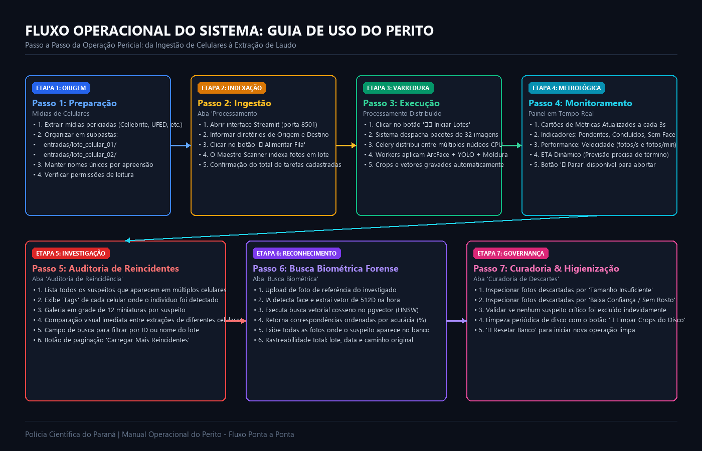
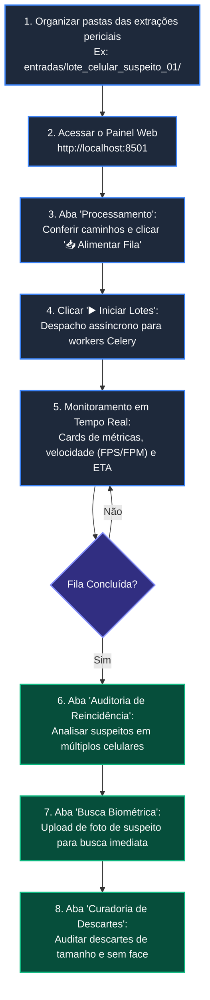

# Manual do Usuário e Guia de Operação Forense
**Sistema ID-Hunter | PeríciaFace-PR**  
*Polícia Científica do Estado do Paraná - SESP-PR*  
*Versão do Manual: 2.4 - Manual Operacional e de Procedimentos Periciais*

---

## 1. Introdução e Princípios Forenses

O **ID-Hunter** é a estação de trabalho pericial dedicada à triagem biométrica facial de grandes volumes de dados não estruturados extraídos de dispositivos móveis apreendidos. 

O sistema foi concebido sob três preceitos fundamentais da criminalística moderna:
1. **Preservação da Cadeia de Custódia Digital:** Todo arquivo analisado é indexado e assinado via hash criptográfico SHA-256. Nenhuma imagem original é alterada ou sobrescrita no diretório de entrada.
2. **Não Destrutividade:** As mídias originais permanecem intactas em modo somente-leitura. Os recortes (crops) são gerados em um diretório de trabalho isolado.
3. **Rastreabilidade e Auditabilidade Total:** Cada rosto recortado mantém vínculo direto com o celular de origem, a data de inserção e a coordenada exata no arquivo original.

---

## 2. Fluxo Operacional do Usuário (Jornada Ponta a Ponta)

O diagrama a seguir sintetiza a jornada do perito criminal, desde a organização física dos arquivos de celulares até a auditoria de cruzamento criminal.





---

## 3. Passo a Passo Operacional por Módulo

### 3.1. Preparação das Mídias de Entrada (Antes de Iniciar o Sistema)
Antes de iniciar a alimentação no sistema, as imagens extraídas dos smartphones periciados devem ser estruturadas em diretórios dentro da pasta de entrada configurada (`PASTA_ORIGEM`):

```text
/app/data/entradas_celular/
 ├── apreensao_celular_alvo_01/
 │    ├── DCIM/
 │    │    ├── IMG_001.jpg
 │    │    └── IMG_002.png
 │    └── WhatsApp Images/
 │         └── foto_003.jpg
 └── apreensao_celular_alvo_02/
      └── Camera/
           └── foto_004.jpeg
```
> [!IMPORTANT]
> O nome da subpasta direta dentro de `entradas_celular` será utilizado automaticamente como o `id_extracao` (ex: `apreensao_celular_alvo_01`). Utilize identificadores significativos para o laudo pericial.

---

### 3.2. Aba 1: Processamento de Fila e Controle de Carga

Esta aba é o centro de comando para indexar, disparar e acompanhar a esteira de processamento distribuído.

#### Controles Principais:
1. **Campos de Diretório:**
   - *Diretório de Origem (Entradas):* Caminho das imagens a serem processadas (padrão container: `/app/data/entradas_celular`).
   - *Diretório de Destino (Crops/Resultados):* Caminho onde os recortes faciais organizados por ID de suspeito serão salvos (padrão: `/app/data/armazenamento_crops`).
2. **Botão `📥 Alimentar Fila`:**
   - Aciona o `maestro_scanner.py`.
   - Lê todas as subpastas, calcula os caminhos relativos e registra no banco relacional como tarefas com status `PENDENTE`.
   - Imagens já cadastradas anteriormente são ignoradas via proteção de unicidade de caminho, evitando duplicações desnecessárias.
3. **Botão `▶️ Iniciar Lotes`:**
   - Inicia o cronômetro do teste de performance.
   - Executa a busca em blocos de **32 imagens** com trava atômica no banco (`SKIP LOCKED`).
   - Despacha os blocos vetorizados para a fila Celery (`processar_lote_faces_tarefa.delay`).
   - Os workers Celery consomem as mensagens em paralelo em múltiplos núcleos de CPU/GPU.
4. **Botão `🛑 Parar`:**
   - Limpa a fila pendente do Celery (`app.control.purge()`).
   - Atualiza todas as tarefas em status `PENDENTE` e `PROCESSANDO` no banco de dados para `CANCELADO`.
   - Limpa o arquivo de métricas de performance.
5. **Botão `🧹 Limpar Crops do Disco`:**
   - Remove com segurança pastas antigas de crops e diretórios de descartes no disco, tratando permissões e vínculos de arquivos do Docker.
6. **Botão `🔄 Resetar Banco`:**
   - Esvazia com transação atômica (`TRUNCATE ... CASCADE`) as tabelas `fila_processamento`, `ocorrencias` e `individuos`. Útil para iniciar uma nova perícia limpa.

#### Painel de Métricas e Relatório em Tempo Real:
A cada 3 segundos, o painel reativo atualiza automaticamente:
- **Pendentes:** Quantidade de imagens ainda aguardando extração.
- **Faces Extraídas:** Quantidade de imagens processadas com sucesso que continham rostos válidos.
- **Sem Face:** Imagens que após a cascata de IA (ArcFace + YOLO + Moldura) não apresentaram faces periciais.
- **Cadastros Únicos:** Total de indivíduos distintos identificados biometricamente na base.
- **Total Ocorrências:** Total de aparições faciais registradas.
- **Velocidade Média:** Taxa em fotos por segundo (`FPS`) e fotos por minuto (`FPM`).
- **ETA (Estimated Time of Arrival):** Estimativa matemática dinâmica do tempo restante para zerar a fila.

---

### 3.3. Aba 2: Auditoria de Reincidência Criminal

O coração investigativo do sistema. Esta tela agrupa e destaca automaticamente os indivíduos que foram detectados em **dois ou mais celulares/lotes diferentes**.

#### Como Operar:
1. **Filtro de Pesquisa:**
   - Digite um UUID de suspeito ou o nome de um lote de extração específico para filtrar a lista instantaneamente.
2. **Card do Reincidente:**
   - **Badge Vermelha `REINCIDENTE`:** Indica que a pessoa está vinculada a múltiplas apreensões.
   - **Tags de Origens:** Lista nominal de todos os celulares onde a pessoa foi encontrada (ex: `apreensao_celular_alvo_01, apreensao_celular_alvo_02`).
   - **Grade de Miniaturas:** Exibe até 12 recortes faciais do indivíduo em alta resolução, ordenados cronologicamente do mais recente para o mais antigo.
3. **Paginação Inteligente:**
   - Caso haja dezenas ou centenas de reincidentes, utilize o botão **`⬇️ CARREGAR MAIS REINCIDENTES`** no rodapé para carregar novos blocos sem recarregar a página inteira.

---

### 3.4. Aba 3: Busca Biométrica Forense

Permite que o perito faça o upload de uma fotografia de referência (ex: foto de documento oficial, foto de mandado de prisão ou imagem de câmera de monitoramento) e busque instantaneamente o indivíduo em todas as extrações do banco.

#### Passo a Passo:
1. Clique em **"Carregar Foto do Suspeito (JPG, PNG, JPEG)"** ou arraste o arquivo.
2. O sistema carrega a imagem, detecta a face principal utilizando o modelo ArcFace e extrai o embedding vetorial normalizado de 512 dimensões.
3. Executa a query de similaridade de cosseno contra todos os registros da tabela `individuos` via índice HNSW:
   $$\text{Acurácia Biometria} = \max(0, (1 - \text{distância}) \times 100)$$
4. **Exibição dos Resultados:**
   - Mostra a foto original do alvo e a face recortada de referência.
   - Lista os indivíduos correspondentes ordenados por acurácia decrescente.
   - Exibe a acurácia biométrica e a distância cosseno exata (quanto menor a distância, maior a certeza pericial).
   - Apresenta todas as aparições do indivíduo no acervo apreendido, com miniatura, lote pericial, data e caminho original do arquivo.

---

### 3.5. Aba 4: Curadoria e Análise de Descartes

Garante que nenhuma evidência legítima seja perdida e permite auditar o rigor do algoritmo.

A tela é subdividida em duas sub-abas:
1. **📏 Tamanho Insuficiente (`_descartados_tamanho`):**
   - Imagens onde foi detectada uma face, porém com dimensões menores que o padrão pericial mínimo (padrão: 60x60 pixels).
2. **📉 Baixa Confiança / Sem Rosto (`_descartados_sem_rosto`):**
   - Imagens onde nem o ArcFace direto, nem o fallback YOLO, nem a moldura artificial conseguiram detectar uma face com pontuação confiável (ex: fotos de objetos, paisagens, documentos de texto ou prints desfocados).
- Ambas as sub-abas possuem galeria em grade com botão de rolagem **`⬇️ CARREGAR MAIS`** para auditoria visual rápida.

---

## 4. Parâmetros Forenses e Calibração

O sistema opera com padrões técnicos rigorosos, exibidos na barra lateral (*sidebar*):

| Parâmetro | Valor Padrão | Justificativa Forense |
|---|---|---|
| **Confiança Mínima de Detecção** | `0.65` | Garante que ruídos e texturas que lembram faces não gerem falsos positivos. |
| **Tolerância Biométrica (Match)** | `0.45` | Limiar ótimo de distância cosseno no espaço latente do ArcFace; valores abaixo de 0.45 representam a mesma pessoa com altíssima probabilidade estatística. |
| **Tamanho Mínimo de Face** | `60px` | Resolução espacial mínima necessária para permitir 5 marcos fiduciais confiáveis (olhos, nariz e cantos da boca). |

---

## 5. Resolução de Problemas (Troubleshooting Forense)

### 1. Botão "Alimentar Fila" exibe "Diretório não localizado"
- **Causa:** O caminho digitado não existe no sistema operacional do container ou host.
- **Solução:** No ambiente Docker, certifique-se de usar caminhos mapeados dentro do volume (ex: `/app/data/entradas_celular`).

### 2. Imagens estão caindo em `_descartados_sem_rosto`
- **Causa:** Fotos com iluminação extremamente precária, rostos de costas ou oclusão total.
- **Ação:** O sistema já tenta automaticamente o resgate via YOLO e borda espelhada. Verifique na aba *Curadoria de Descartes* se a imagem realmente continha um rosto legível.

### 3. Erro de permissão ao clicar em "Limpar Crops do Disco"
- **Causa:** O container Docker criou pastas com permissão de superusuário (`root`).
- **Solução:** O botão executa internamente uma rotina Python com `os.chmod(..., stat.S_IWRITE)`. Caso persista em Linux host, execute:
  ```bash
  sudo chown -R $USER:$USER ./data/armazenamento_crops
  ```

### 4. Celery Workers sem responder
- **Causa:** Redis desconectado ou memória RAM insuficiente.
- **Solução:** Reinicie os containers via terminal:
  ```bash
  docker compose restart worker broker
  ```
