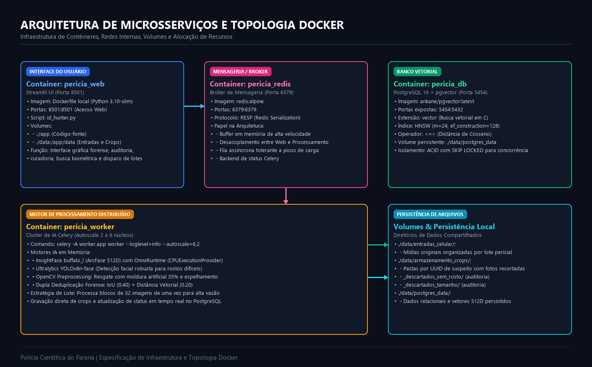
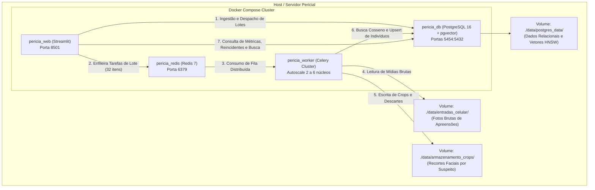

# Arquitetura Técnica, Componentes e Especificação de Código
**Sistema ID-Hunter | PeríciaFace-PR**  
*Polícia Científica do Estado do Paraná - SESP-PR*  
*Versão Técnica: 2.4 - Documento de Engenharia de Software e Infraestrutura*

---

## 1. Visão Geral da Arquitetura e Fase Atual

O **ID-Hunter** encontra-se na fase de **Produção Piloto / MVP Operacional Avançado**. A aplicação é construída sob o paradigma de **Microsserviços em Contêineres Docker**, desacoplando a interface de usuário, a mensageria de tarefas assíncronas, o cluster de inferência de Inteligência Artificial e o banco de dados vetorial relacional.

A arquitetura foi projetada para garantir **alta vazão (throughput)** na análise de dezenas de milhares de fotos de celulares apreendidos, mantendo a integridade transacional e a precisão biométrica em nível forense.





---

## 2. Especificação Detalhada por Arquivo do Sistema

### 2.1. `worker.py` (Cluster de Inferência e Extração Biométrica)
- **Papel:** Worker do Celery responsável por processar as tarefas de visão computacional em paralelo.
- **Motores Carregados em Memória:**
  1. `insightface.app.FaceAnalysis(name="buffalo_l", providers=["CUDAExecutionProvider", "CPUExecutionProvider"])`:
     - Modelo de detecção facial de alta resolução (`det_thresh=0.35`, resolução $640 \times 640$).
     - Modelo ArcFace (rede neural convolucional profunda) para extração de vetor denso normalizado de **512 dimensões**.
  2. `ultralytics.YOLO("yolov8n-face.pt")`:
     - Rede neural convolucional leve customizada para detecção de rostos difíceis, com oclusões parciais, bonés ou em ângulos laterais.
- **Lógica Forense de Extração (`_processar_imagem_individual`):**
  - **Identificação Unívoca:** Gera o hash SHA-256 do arquivo original para a cadeia de custódia.
  - **Correção de Orientação:** Aplica `ImageOps.exif_transpose` para corrigir fotos rotacionadas por sensores de celulares.
  - **Cascata em 3 Estágios:**
    - *Estágio A:* Detecção direta com ArcFace.
    - *Estágio B (Fallback):* Se o Estágio A não encontrar faces, roda o YOLOv8n (`conf=0.60`), expande a caixa delimitadora em 50% de margem de segurança e aplica o ArcFace no recorte da pessoa.
    - *Estágio C (Resgate por Moldura Artificial):* Se ainda assim nenhuma face for identificada, adiciona uma borda cinza constante (`[128, 128, 128]`) de 35% nas quatro extremidades da imagem e testa a versão original e a versão espelhada horizontalmente.
  - **Deduplicação Intra-Imagem:**
    - Filtro IoU (`_dedup_detections` com limiar 0.40) para eliminar caixas sobrepostas do mesmo rosto.
    - Filtro de similaridade vetorial (`_dedup_por_embedding` com limiar cosseno 0.20) para evitar duplicatas em reflexos ou sombras.
  - **Persistência de Crops:**
    - Cria pastas nomeadas com o UUID do indivíduo (`/app/data/armazenamento_crops/<UUID>/`).
    - Salva o recorte da face em JPG com nomenclatura forense: `celular_<id_extracao>_face_<idx>_<nome_original>`.
  - **Tarefas Celery Exportadas:**
    - `processar_lote_faces_tarefa(lote_tarefas)`: Tarefa em lote otimizada para consumir pacotes de até 32 imagens sequencialmente dentro do mesmo processo worker, minimizando *overhead* de mensageria.
    - `extrair_faces_tarefa(...)`: Tarefa unitária legada mantida para compatibilidade.

---

### 2.2. `database_manager.py` (Gerenciador do Banco Relacional e Vetorial)
- **Papel:** Camada de persistência, controle de concorrência e busca vetorial com PostgreSQL 16 e extensão `pgvector`.
- **Esquema Relacional e Índices:**
  - `individuos`: Armazena a identidade biométrica única (`id UUID`, `embedding VECTOR(512)`).
    - Índice: `CREATE INDEX idx_individuos_embedding_hnsw ON individuos USING hnsw (embedding vector_cosine_ops) WITH (m = 24, ef_construction = 128)`.
  - `ocorrencias`: Armazena todas as aparições históricas vinculadas a um indivíduo (`id UUID`, `individuo_id UUID`, `id_extracao VARCHAR(50)`, `hash_sha256 VARCHAR(64) UNIQUE`, `caminho_arquivo TEXT`, `caminho_crop TEXT`, `data_ocorrencia TIMESTAMP`).
  - `fila_processamento`: Fila de tarefas gerenciada pelo banco (`id SERIAL`, `id_extracao VARCHAR(50)`, `caminho_arquivo TEXT UNIQUE`, `status VARCHAR(20)`, `data_criacao TIMESTAMP`).
- **Principais Funções:**
  - `conectar_banco()`: Cria a extensão `vector`, registra o tipo no `psycopg2` e ajusta `SET hnsw.ef_search = 100` para máxima acurácia na busca vetorial em tempo real.
  - `buscar_similar(vetor_novo, limite_distancia=0.38)`: Executa consulta SQL com o operador `<=>` (distância de cosseno) para encontrar o indivíduo mais próximo.
  - `registrar_face(...)`:
    - Normaliza o vetor ($L_2$).
    - Verifica similaridade no banco. Se a menor distância for menor que `limite_distancia`, classifica como **REINCIDENTE** e obtém a lista de lotes prévios. Se não, insere em `individuos` com status **NOVO**.
    - Insere o registro em `ocorrencias`. Caso haja colisão de `hash_sha256`, o banco aciona `psycopg2.IntegrityError` e trata como duplicata legítima de arquivo idêntico.
  - `pegar_tarefas_em_lote(limite=50)`:
    - Executa `UPDATE fila_processamento SET status = 'PROCESSANDO' WHERE id IN (SELECT id FROM fila_processamento WHERE status = 'PENDENTE' ORDER BY id ASC LIMIT %s FOR UPDATE SKIP LOCKED) RETURNING ...`.
    - A instrução **`FOR UPDATE SKIP LOCKED`** é crucial: garante que múltiplos despachantes ou processos nunca peguem a mesma tarefa, eliminando condições de corrida (*race conditions*).
  - `obter_reincidentes_banco()`: Agrupa suspeitos que possuem `COUNT(DISTINCT id_extracao) > 1` e monta o histórico com links de crops e lotes envolvidos.

---

### 2.3. `id_hunter.py` (Painel Web Pericial Streamlit)
- **Papel:** Interface gráfica, central de controle de lotes, monitoramento reativo e ferramenta de busca biométrica.
- **Arquitetura de UI:**
  - Desenvolvido em **Streamlit** com customização visual escura em CSS corporativo (`#0b0f19`, `#1e293b`).
  - Utiliza decoradores modernos `@st.fragment(run_every="3s")` para atualizar os cartões métricos de progresso, velocidade (FPS/FPM) e ETA dinâmico **sem piscar a tela ou recarregar os inputs do perito**.
  - Persiste o horário de início da operação em arquivo JSON (`metricas_teste.json`) para calcular médias móveis de vazão de dados.
- **Abas Funcionais:**
  - `tab_processamento`: Seleção de diretórios, botões de ação (Alimentar, Iniciar, Parar, Limpar, Resetar) e cards de métricas.
  - `tab_auditoria`: Filtro dinâmico por UUID ou Lote, listagem com badges de reincidência e galeria de 12 miniaturas por suspeito com paginação por botão.
  - `tab_busca`: Upload de imagem com processamento em tempo real do ArcFace, cálculo de acurácia em porcentagem e tabela de ocorrências no acervo.
  - `tab_curadoria`: Visualizador das pastas `_descartados_tamanho` e `_descartados_sem_rosto` para garantia de qualidade pericial.

---

### 2.4. `maestro_scanner.py` (Scanner de Pastas de Extração)
- **Papel:** Indexador de mídias de alta velocidade via linha de comando ou integração com a UI.
- **Mecanismo:**
  - Varre todas as subpastas da pasta raiz informada.
  - O nome da subpasta de primeiro nível é mapeado como `id_extracao`.
  - Monta lote de dicionários e chama `enfileirar_tarefas_em_lote` do `database_manager.py`, inserindo milhares de registros com um único comando SQL `execute_values`.

---

### 2.5. `docker-compose.yml` e `dockerfile` (Orquestração de Infraestrutura)
- **Serviços Orquestrados:**
  1. `db`: Imagem `ankane/pgvector:latest` com PostgreSQL 16 e extensão de vetores compilada nativamente. Porta exposta: `5454:5432`.
  2. `broker`: Imagem `redis:alpine` para mensageria assíncrona. Porta exposta: `6379:6379`.
  3. `web`: Aplicação Streamlit rodando na porta `8501`.
  4. `worker`: Processador Celery com autoscale dinâmico: `celery -A worker.app worker --loglevel=info --autoscale=6,2`. Aloca dinamicamente de 2 a 6 processos em função da carga da fila.
- **Volumes Persistentes:**
  - `./data/postgres_data`: Persistência dos dados relacionais e dos arquivos de índice HNSW do PostgreSQL.
  - `./data`: Mapeado para `/app/data` em todos os contêineres, permitindo acesso compartilhado às pastas de entradas de celulares e armazenamento de crops.

---

## 3. Especificação dos Modelos de Inteligência Artificial

| Modelo | Arquitetura | Framework / Engine | Entrada / Resolução | Saída Gerada | Propósito Forense |
|---|---|---|---|---|---|
| **ArcFace (InsightFace)** | Backbone Buffalo_L (ResNet-50 / IResNet) | ONNX Runtime (CPUExecutionProvider) | $640 \times 640$ BGR | Vetor 512D ($\mathbb{R}^{512}$) + 5 marcos fiduciais | Extração da biometria facial invariante a iluminação e idade. |
| **YOLOv8n-Face** | Rede Convolucional Unificada (Ultralytics) | PyTorch / TorchScript | Variável (auto-scale) | Caixas delimitadoras $[x_1, y_1, x_2, y_2]$ + confiança | Detecção robusta sob oclusões severas e ângulos de até 90°. |

---

## 4. Matriz Completa de Dependências do Projeto

| Biblioteca | Versão Instalada | Categoria | Finalidade no Sistema |
|---|---|---|---|
| `insightface` | 1.0.1 | Visão Computacional / IA | Motor de alinhamento e extração facial ArcFace 512D. |
| `ultralytics` | 8.x | Detecção de Objetos / IA | Motor YOLOv8n-Face para resgate de rostos com oclusões. |
| `onnxruntime` | 1.25.1 | Inferência de IA | Engine de execução de tensores de alta performance para CPU/GPU. |
| `torch` | 2.11.0 | Deep Learning | Backend do YOLOv8 e cálculo vetorial. |
| `opencv-python` | 5.0.0 | Processamento de Imagens | Leitura de imagem BGR, desenho de bboxes, flips e padding. |
| `pillow` | 12.2.0 | Manipulação de Imagens | Leitura de metadados EXIF e normalização de orientação. |
| `celery` | 5.x | Processamento Distribuído | Gerenciamento de tarefas em background e cluster de workers. |
| `redis` | alpine (Docker) | Mensageria / Broker | Fila de mensagens em memória de baixa latência. |
| `psycopg2-binary`| 2.9.11 | Banco de Dados | Driver PostgreSQL com suporte a transações e pools de conexão. |
| `pgvector` | 0.5.0 | Álgebra Vetorial SQL | Tipos e operadores de busca vetorial cosseno e índice HNSW no Postgres. |
| `streamlit` | 1.57.0 | Interface de Usuário | Painel web interativo pericial e monitoramento em tempo real. |
| `numpy` | 2.5.2 | Computação Científica | Álgebra linear, normalização $L_2$, cálculo de IoU e distâncias. |
| `fpdf2` | 2.8.7 | Relatórios Forenses | Geração programática de relatórios periciais e laudos em PDF. |

---

## 5. Ciclo de Vida dos Dados e Fases de Processamento

```text
+-------------------+      +----------------------+      +----------------------+
| 1. INGESTÃO       | ---> | 2. FILA ASSÍNCRONA   | ---> | 3. INFERÊNCIA & IA   |
| Pastas de Celular |      | PostgreSQL (PENDENTE)|      | InsightFace + YOLO   |
| maestro_scanner   |      | Redis (Lotes de 32)  |      | Resgate por Moldura  |
+-------------------+      +----------------------+      +----------------------+
                                                                    |
                                                                    v
+-------------------+      +----------------------+      +----------------------+
| 6. LAUDO & UI     | <--- | 5. AUDITORIA FORENSE | <--- | 4. VETORIZAÇÃO & BD  |
| Painel Streamlit  |      | Reincidentes em Lotes|      | Normalização L2      |
| Busca Biométrica  |      | Curadoria Descartes  |      | pgvector HNSW (<=>)  |
+-------------------+      +----------------------+      +----------------------+
```

1. **Fase de Ingestão:** Varredura física das pastas de celulares apreendidos e cadastro em lote na tabela relacional `fila_processamento`.
2. **Fase de Fila:** Despacho concorrente sem concorrência suja utilizando transações seguras `FOR UPDATE SKIP LOCKED`.
3. **Fase de Inferência & Resgate:** Aplicação da cascata de IA com 3 camadas defensivas para maximizar a captura de suspeitos.
4. **Fase de Vetorização & Indexação:** Geração de vetores unitários de 512 dimensões e busca no grafo HNSW via distância de cosseno.
5. **Fase de Auditoria:** Identificação de conexões criminais entre celulares distintos e segregação de descartes.
6. **Fase de Apresentação:** Visualização em tempo real de métricas, busca por fotografia de referência e exportação de evidências.
